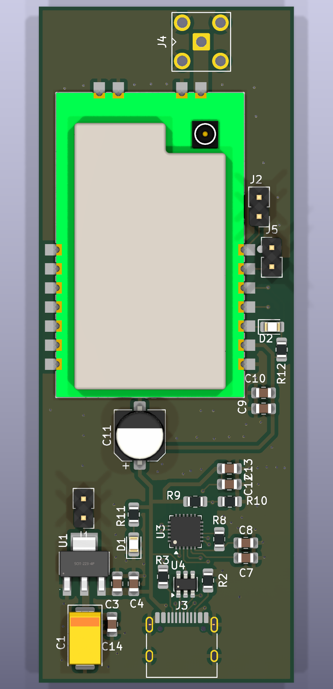

# Yer İstasyonu — CP2102N sürümü



```
USB-C  ->  CP2102N (USB-UART)  ->  E220-900T30S (LoRa, 30 dBm)  ->  SMA anten
```

## Kart

- 2 katman FR4, 1.6 mm, 34 x 90 mm
- Bütün parçalar üst yüzde
- Pasifler 0805 (lehimleme için geniş pedli)

## Ana parçalar

| Ref | Parça | Not |
|---|---|---|
| U3 | CP2102N-A02-GQFN24R | USB-UART, kendi 3.3V regülatörüyle beslenir |
| U2 | E220-900T30S | LoRa modülü, VBUS'tan (5V) beslenir |
| U1 | AMS1117-3.3 | 3.3V çıkışı sadece J1 başlığına gider |
| U4 | SRV05-4 | USB veri hatları için ESD koruma |
| J3 | HRO TYPE-C-31-M-12 | USB-C; CC hatlarında 5.1k (R2, R3) |
| J4 | BWSMA-KWE-Z001 | Dik açılı SMA |
| J2, J5 | Pin başlığı | M0 / M1 seçimi (jumper takılı = 0) |
| D1 | Yeşil LED | Güç göstergesi |
| D2 | Yeşil LED | Paket göstergesi: VBUS → R12 (1k) → D2 → E220 AUX; AUX LOW (meşgul) iken yanar |

## Anten hattı

E220'den SMA'ya 6.9 mm'lik eş düzlemli hat (GCPW): yol 2.0 mm, iki yanda 0.5 mm boşluk,
altta dolu GND. 1.6 mm FR4 (εr ≈ 4.5) için yaklaşık 50 Ω.

## Dosyalar

| Dosya | İçerik |
|---|---|
| `yer istasyonu.kicad_pro / _sch / _pcb` | KiCad 10 projesi |
| `uretim/gerber.zip` | Gerber + delik dosyaları |
| `uretim/sema.pdf` | Devre şeması |
| `uretim/pcb.pdf` | PCB üst yüz (sayfa 1) ve alt yüz (sayfa 2, aynalı) |
| `uretim/alisveris_listesi.xlsx` | Özdisan + LCSC parça listesi (25.10.2026 stok/fiyat) |

## Kullanım

- Anten takılı değilken karta güç vermeyin.
- J2 ve J5 jumper takılı: M0 = M1 = 0, normal çalışma. M0 = M1 = 1 ayar modudur.
- E220 gönderim anında ~610 mA çeker. En az 1 A verebilen bir USB port ya da adaptör kullanın.
- Seri port: Silicon Labs CP210x sürücüsü, 9600 baud 8N1 (E220 fabrika ayarı).
- D2 her paket gönderiminde ve alımında kısa süre yanar. Karta güç verilince de E220'nin
  açılış kontrolü sırasında bir kez yanıp söner.
- D2 yerine kırmızı/sarı LED takmayın: Vf ~2 V olan LED, AUX HIGH iken de hafif yanar ve
  AUX pinine akım gönderir. Bu devre Vf'si 2.7–3.4 V olan yeşil LED'e göre hesaplandı.

## Bilinen durumlar

- DRC (KiCad 10.0.8, D2/R12 dahil): eksik bağlantı ve boşluk hatası yok. E220'nin 9. pini
  (GND) döküme tek kolla bağlı; çalışmayı etkilemez.
- Baskı (silkscreen) uyarıları: C12 ile C13'ün etiketleri üst üste biniyor, D2 etiketi
  kendi çerçevesine değiyor. Sadece görünüş; elektriksel etkisi yok.
- C5 (10 µF) ve C6 (100 nF) şemada var, PCB'de yok.
- `3d_ust.png`: USB-C (J3) ve SMA (J4) için KiCad kütüphanesinde 3D model olmadığından bu
  ikisi gövdesiz görünür.
- Asitle üretimde vialar kaplamasızdır: her viaya tel geçirip iki yüzden lehimleyin
  (vialar 0.6 / 0.3 mm).
